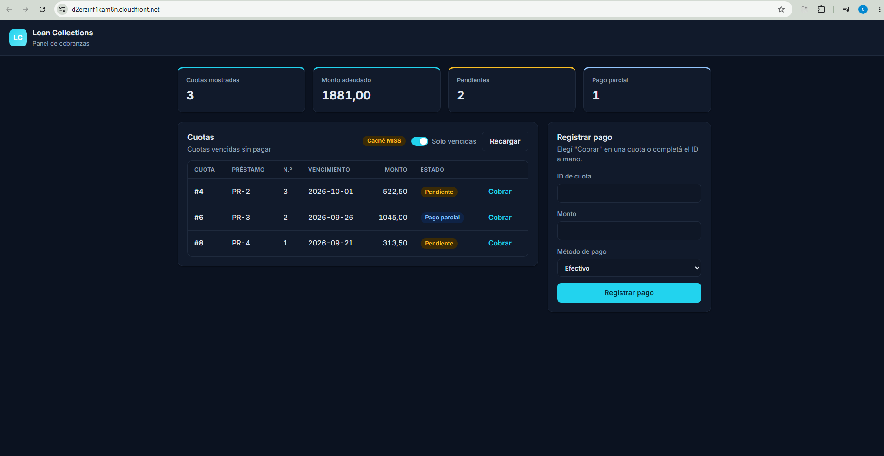
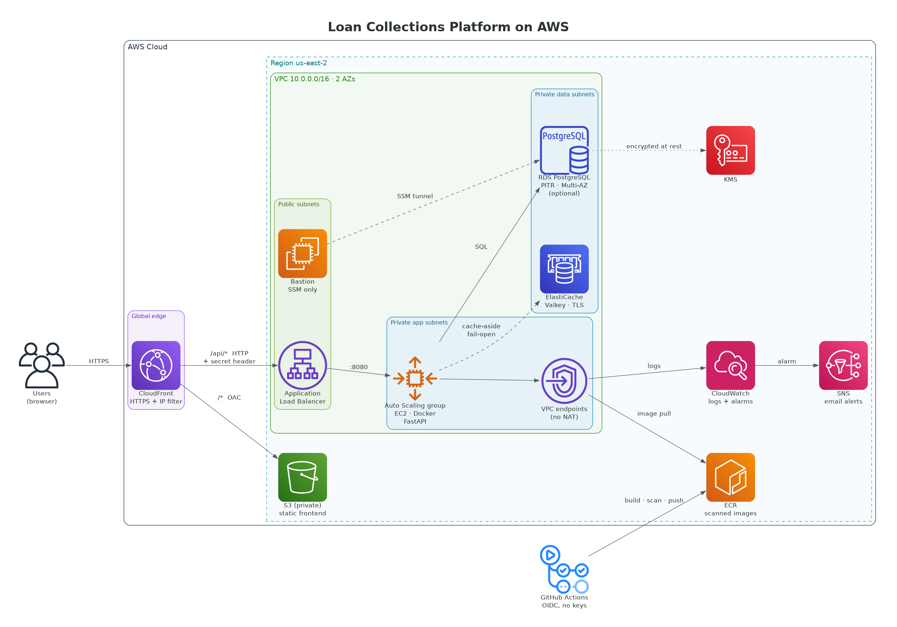
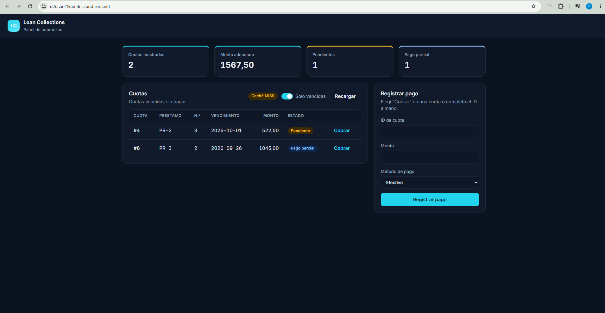
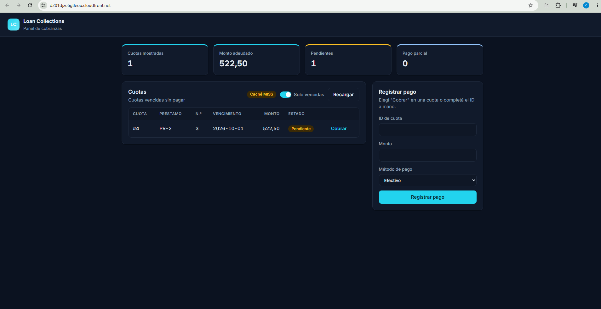

# Loan Collections Platform (AWS)

[Español](README.es.md) · **English**

**A loan and collections management system on a three-tier AWS architecture**: custom VPC across 2 AZs, EC2 Auto Scaling behind an Application Load Balancer, RDS PostgreSQL, ElastiCache, CloudFront with an S3-hosted frontend, CI/CD with GitHub Actions, and all infrastructure as code in CloudFormation.

Built as hands-on preparation for the **AWS Certified Solutions Architect – Associate (SAA-C03)**. Every design decision is recorded in an ADR, and every resilience test is **measured and kept as evidence**.




> The UI, ADRs and test evidence are written in Spanish; this README summarizes them in English.

---

## Measured results

Every figure comes from real tests against the deployed infrastructure. Full outputs are in [`docs/evidence/`](docs/evidence/).

| Test | Result | Evidence |
|---|---|---|
| Forced RDS Multi-AZ failover | Client saw **≤ 15 s of errors** (2 failed requests); RDS reported ~49 s. The app recovered on its own, no restarts | [multiaz-e2e](docs/evidence/module-11-multiaz-e2e.txt) |
| Terminate the only EC2 instance | **Client-side RTO: 2 min 50 s**. ASG detection: 81 s. Launch → 200: 94 s | [multiaz-e2e](docs/evidence/module-11-multiaz-e2e.txt) |
| RDS point-in-time restore | **RPO 4 min 26 s · RTO 28 min 40 s** (data tier only) | [pitr-drill](docs/evidence/module-11-pitr-drill.txt) |
| Cross-region snapshot copy (us-east-2 → us-west-2) | 1 min 37 s, encrypted with the destination region's KMS key | [cross-region](docs/evidence/module-11-cross-region-snapshot.txt) |
| Injected failure (container stopped) | Alarm MTTD ~8 min. Found a **false OK** (MinSize 0 + target tracking) and fixed it | [observability](docs/evidence/module-09-observability-e2e.txt) |
| Payment on an already-paid installment or above the balance | **409** in both cases; `SELECT … FOR UPDATE` serializes concurrent payments | [frontend-e2e](docs/evidence/module-12a-frontend-e2e.txt) |
| Bring the full environment up / down | `up` ≈ 10–13 min (CloudFront takes 6–9) · `down` ≈ 8 min | [cicd-release](docs/evidence/module-10-cicd-release-e2e.txt) |

**Key takeaway:** with Multi-AZ the database recovers in seconds, so the availability weak point is **single-instance compute**, not RDS. The next step would be `Desired 2` (one instance per AZ).

---

## Architecture



<sub>Diagram generated as code from [`docs/diagram/architecture.py`](docs/diagram/architecture.py) with the official AWS icons.</sub>

**Request flow:** the browser hits a single CloudFront URL. A CloudFront Function filters by IP. The `*` behavior serves the UI from a **private** S3 bucket through OAC, and `/api/*` goes to the ALB with a secret header that the listener validates. The ALB security group only allows CloudFront's *prefix list*. EC2 instances run in private subnets **without a NAT Gateway**: they pull the image from ECR and ship logs through VPC Endpoints. RDS and ElastiCache only accept traffic from the app security group.

UI and API share the same origin, so **no CORS is needed** ([ADR-0018](docs/adr/0018-static-frontend-s3-oac-same-cloudfront-distribution.md)).

---

## AWS services and why

| Layer | Service | Key decision | ADR |
|---|---|---|---|
| Network | VPC, 6 subnets across 2 AZs, layered security groups | Three-tier: public / app / data | [0001](docs/adr/0001-vpc-design.md), [0005](docs/adr/0005-iam-least-privilege-and-layered-security-groups.md) |
| Network | 7 VPC Endpoints instead of a NAT Gateway | Cheaper, and no internet egress from private subnets | [0002](docs/adr/0002-conditional-nat-gateway.md), [0009](docs/adr/0009-vpc-endpoints-and-ssm-parameter-store.md) |
| Compute | EC2 + Auto Scaling + Launch Template | Docker on EC2 (not ECS) to cover EC2/ASG exam topics | [0005](docs/adr/0005-iam-least-privilege-and-layered-security-groups.md) |
| Load balancing | Application Load Balancer | Deliberately shallow health check (avoids cascading replacements if RDS fails) | [0010](docs/adr/0010-alb-http-temporary-and-free-plan-cost-model.md) |
| Data | RDS PostgreSQL 16 | Single-AZ for cost, Multi-AZ as a parameter (tested), PITR and DeletionProtection | [0003](docs/adr/0003-rds-single-az-free-tier.md), [0017](docs/adr/0017-ha-dr-strategy-single-az-pitr-and-regional-backup-restore.md) |
| Cache | ElastiCache Valkey | Cache-aside with a date-based key and fail-open | [0011](docs/adr/0011-elasticache-valkey-cache-aside.md) |
| Edge | CloudFront + CloudFront Functions | HTTPS without a custom domain; IP filtering at the edge | [0013](docs/adr/0013-https-via-cloudfront-without-custom-domain.md) |
| Frontend | Private S3 + OAC | Same distribution, path-based behaviors | [0018](docs/adr/0018-static-frontend-s3-oac-same-cloudfront-distribution.md) |
| Admin access | Bastion + SSM Session Manager | No open SSH and no keys; SSM tunnel to RDS | [0004](docs/adr/0004-bastion-ssm-access.md) |
| Observability | CloudWatch Logs (JSON), metric filters, 6 alarms, SNS | Alarms on `ELB_5XX` and `HealthyHostCount`, not just on the app | [0014](docs/adr/0014-observability-logs-alarms-and-sns.md) |
| CI/CD | GitHub Actions, OIDC, ECR scan | Publish ≠ promote: manual promotion to production | [0015](docs/adr/0015-cicd-github-actions-oidc-scan-gate-and-manual-promotion.md) |

---

## Security

- **No long-lived credentials:** GitHub Actions assumes a role via **OIDC**; instances use a least-privilege instance profile.
- **Secrets:** the RDS password lives in **SSM Parameter Store (SecureString)** and CloudFormation resolves it with `ssm-secure`. It is never in the repo or in stack parameters.
- **Network:** ALB → EC2 → RDS chained through security groups; no public IPs on RDS or EC2; the ALB is only reachable from CloudFront (prefix list + secret header).
- **Data:** RDS encrypted (KMS); bucket with Block Public Access ×4, SSE-S3, and a policy that enforces TLS and the distribution's `AWS:SourceArn`.
- **Container:** non-root user and ECR-scanned image. A *scan gate* blocks promotion on unaccepted HIGH/CRITICAL findings. Risk acceptances are documented: [0006](docs/adr/0006-ecr-image-vulnerability-risk-acceptance.md), [0008](docs/adr/0008-zlib-residual-risk-final-acceptance.md), [0012](docs/adr/0012-perl-pod-text-cve-risk-acceptance.md), [0016](docs/adr/0016-libstdcxx-pcre2-cve-risk-acceptance-and-gate-allowlist.md).

---

## Cost

The account runs on the **Free plan with credits**. To keep spending minimal, the infrastructure is split in two groups:

- **Always on:** VPC, RDS `db.t3.micro` Single-AZ, bastion, ECR, frontend bucket. About **USD 1.4 per day**.
- **On demand** via `scripts/env.sh`: VPC Endpoints, ALB, CloudFront and the ASG. Created for each test session and destroyed afterwards.

Example: enabling Multi-AZ for ~77 min for the failover test cost ~USD 0.02 ([ADR-0010](docs/adr/0010-alb-http-temporary-and-free-plan-cost-model.md)).

---

## How to deploy

**Requirements:** AWS CLI v2 with a profile that has the needed permissions, `cfn-lint`, and Docker.

1. Deploy the base stacks in order, through reviewed change sets: `00` (OIDC) → `01-vpc` → `bastion` → `02-rds` → `03-security` → `04-ecr` → `05-compute` → `06-alb` → `07-cache` → `08-monitoring` → `09-cicd` → `10-frontend`.
2. Upload the frontend:
   ```bash
   aws s3 sync frontend/ s3://<frontend-bucket> --delete --cache-control no-cache
   ```
3. Operate the environment with the script:
   ```bash
   ./scripts/env.sh status          # current state (read-only)
   ./scripts/env.sh promote <tag>   # tags prod-<tag> and updates ImageTag (only with the ASG at 0)
   ./scripts/env.sh up              # endpoints → ALB/CloudFront → ASG; waits for /api 200
   ./scripts/env.sh down            # reverse order
   ```

`env.sh` always reads templates from **`origin/main`**, never from the working tree: only what has gone through a PR gets deployed.

**Pipeline:** `pr-ci` (cfn-lint + build + smoke test) on every PR → merge → `release` builds, pushes to ECR and waits for the scan → **manual promotion** with `env.sh promote`.

---

## Repository structure

```
├── app/                 FastAPI API (routers, SQLAlchemy models, Pydantic schemas, cache)
├── frontend/            static UI (plain HTML/CSS/JS, no framework)
├── database/            schema.sql, seed.sql, demo-data.sql
├── infrastructure/      CloudFormation templates 00–10 + bastion
├── scripts/env.sh       bring up / tear down / promote
├── docs/adr/            18 Architecture Decision Records
├── docs/evidence/       E2E and resilience test outputs
├── docs/screenshots/    UI screenshots
├── .github/workflows/   pr-ci.yml, release.yml
└── Dockerfile
```

---

## Technical debt and future improvements

Kept visible on purpose: I know the limits of this design and what the next step would be in each case.

**Availability**
- `Desired 2` (one instance per AZ) and **Instance Refresh** (`MinHealthyPercentage 100`) for zero-downtime deploys.
- A real restore in the DR region: so far only the snapshot was copied; the VPC, image and parameters are still missing there.

**Testing**
- Automated tests for write paths (payment POST) in `pr-ci`. Today the smoke test only covers `/health`.
- Real concurrency with two simultaneous payments: the `FOR UPDATE` was reasoned about but not executed in parallel.

**Application**
- "Amount owed" does not subtract partial payments (the API should return the balance).
- The `late` status is unused: either an EventBridge Scheduler job sets it, or it gets removed.
- `amount_paid` accepts values ≤ 0 (missing `Field(gt=0)`) and there is no `Idempotency-Key`.

**Operations and security**
- Automate the frontend `s3 sync` and add the cache stack to `env.sh up`.
- Custom domain + ACM so traffic between CloudFront and the ALB is HTTPS as well.
- Automatic RDS password rotation (Secrets Manager), ruled out for cost.
- Least privilege for the administrative role used for deployments as well.

---

## Project status

**Completed** (October 2026). All infrastructure was decommissioned when the account credits expired (2026-10-21), so **there is no live URL**: proof that everything worked lives in [`docs/evidence/`](docs/evidence/) and [`docs/screenshots/`](docs/screenshots/).

| Before payment | After payment | Payment validation (409) |
|---|---|---|
|  |  |  |

---

**Author:** Cristian Andrés Rueda Arteaga · [GitHub](https://github.com/CristianAndres-Arteaga) · Licensed under [MIT](LICENSE)
